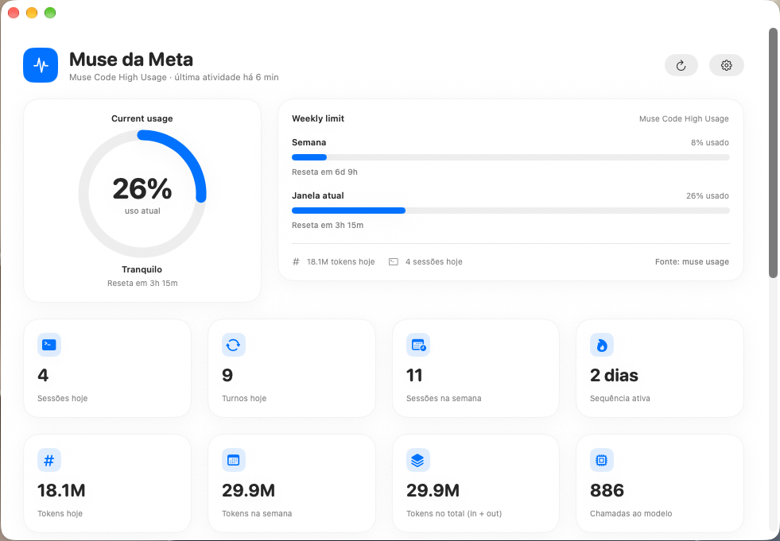
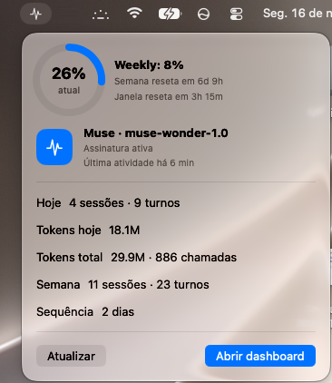
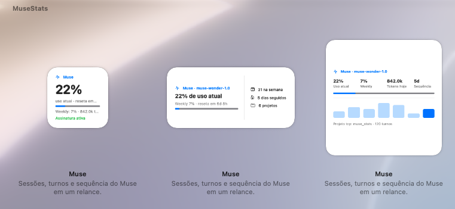

<div align="center">
  

  <h1>MuseStats</h1>

  <p><strong>Seu uso do Muse Code, em um relance.</strong></p>
  <p>App nativo para macOS que reúne limites de uso, sessões e tokens do Muse Code da Meta.</p>

  <p>
    <code>macOS 14+</code> · <code>SwiftUI</code> · <code>WidgetKit</code>
  </p>

  <p>
    <a href="#recursos">Recursos</a> ·
    <a href="#capturas">Capturas</a> ·
    <a href="#como-executar">Como executar</a> ·
    <a href="#fontes-de-dados">Fontes de dados</a>
  </p>

  
</div>

## Recursos

- **Limites de uso** — acompanhe a janela atual e o limite semanal, com o tempo até a próxima renovação.
- **Histórico de atividade** — veja sessões, turnos, tokens de entrada e saída, chamadas ao modelo, projetos mais usados e sequência de dias ativos.
- **Barra de menus** — confira o resumo do dia e da semana, atualize os dados ou abra o painel.
- **Widgets** — adicione o resumo do Muse à mesa do macOS nos tamanhos pequeno, médio ou grande.
- **Atualização automática** — o app consulta os dados ao abrir e a cada cinco minutos enquanto está em execução. Também é possível atualizar manualmente.

## Capturas

| Barra de menus | Widgets |
| :---: | :---: |
|  |  |

## Como executar

**Requisitos:** macOS 14 ou posterior, Xcode e, para exibir dados reais, o CLI do Muse instalado, autenticado e com sessões registradas neste Mac.

1. Abra `MuseStats.xcodeproj` no Xcode.
2. Em **Signing & Capabilities**, selecione seu time nos targets `MuseStats` e `MuseStatsWidgetExtension`. Os dois precisam compartilhar o mesmo App Group. O identificador do projeto é `group.com.andersonaires.musestats`. Se precisar trocá-lo, atualize os dois targets e [`SharedStore.swift`](Shared/SharedStore.swift).
3. Selecione o scheme **MuseStats** e pressione **⌘R** para abrir o app.
4. Para instalar o widget, clique com o botão direito na mesa, escolha **Editar Widgets** e adicione **Muse**.

Para compilar pelo terminal, execute na raiz do projeto após configurar a assinatura:

```sh
xcodebuild build -project MuseStats.xcodeproj -scheme MuseStats
```

> O app procura o CLI em `~/.local/bin/muse`, `/opt/homebrew/bin/muse` e `/usr/local/bin/muse`. Se os limites aparecerem como indisponíveis, confira se o executável está em um desses caminhos e se `muse usage --json` funciona no terminal.

## Fontes de dados

| Fonte | O que alimenta |
| --- | --- |
| `muse usage --json` | Percentuais e horários de renovação da janela atual e do limite semanal. O comando usa a autenticação do próprio Muse e não inicia um turno de modelo. |
| `~/.local/share/muse/session-index.db` | Sessões, turnos, projetos, modelos e datas. O app abre uma cópia temporária do SQLite em modo somente leitura. |
| `~/.local/share/muse/sessions/**/session.jsonl` | Contagem de tokens de entrada e saída e chamadas ao modelo, a partir dos eventos de uso registrados pelo Muse. |
| `~/.config/muse/auth.json` | Metadados da conta Meta e da assinatura. O app extrai os campos usados na interface e ignora os campos de credenciais. |

Se o comando de uso falhar, as métricas locais continuam disponíveis e a interface sinaliza que os limites estão indisponíveis. Se o índice de sessões estiver inacessível ou vazio, o app exibe dados de demonstração.

O app acessa os arquivos locais do Muse sem App Sandbox. O widget roda em sandbox e consulta o resumo salvo pelo app no App Group.

## Estrutura do projeto

| Pasta | Conteúdo |
| --- | --- |
| [`MuseStats/`](MuseStats/) | App SwiftUI, dashboard, barra de menus e serviço de leitura de dados. |
| [`MuseStatsWidget/`](MuseStatsWidget/) | Extensão WidgetKit com os três tamanhos do widget. |
| [`Shared/`](Shared/) | Modelos e armazenamento compartilhado entre o app e o widget. |
